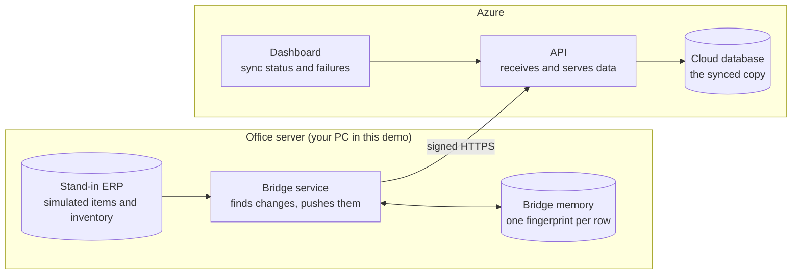

# erp-sync

Near-real-time sync from an on-premise ERP to the cloud: a C# bridge service that detects changes, an ASP.NET Core API that receives them, and a React dashboard that shows what synced and what failed.

**Status:** in progress. Target for a live demo: December 18, 2026. Progress is tracked in [Milestones](../../milestones) and [Issues](../../issues).

## Why this exists

Many mid-market ERPs run on an office server and cannot tell outside systems when something changes. Websites, marketplaces, and shipping tools end up working from data that is minutes or hours old.

I built and run a production bridge that solves this for a wholesale distributor on Sage 100. It keeps about 30 ERP tables mirrored to a web platform and feeds inventory to three sales channels. That system is written in PHP and syncs on a five-minute schedule.

This repo is a ground-up rebuild of the core idea in .NET, on simulated data, with a faster design:

- a service that runs continuously, not on a schedule
- changes pushed the moment they are found, not pulled later
- a target of under 30 seconds from ERP change to cloud copy

No client data, names, or item codes appear anywhere in this repo.

## How it works

1. The bridge reads rows from the ERP using a narrow column list.
2. It turns each row into a fingerprint (a hash of its contents) and compares it to the fingerprint saved on the last cycle.
3. New, changed, and missing fingerprints become inserts, updates, and deletes.
4. Only those rows are sent to the API, each with a revision number that only goes up.
5. The API saves a row only if the incoming revision is newer, so a retry after a network failure can never corrupt the copy.

The ERP reader sits behind an interface. This repo ships a reader for the simulated ERP. A reader for a real ERP can be swapped in without touching the rest of the bridge.

## Tech

| Piece          | Built with                                           |
| -------------- | ---------------------------------------------------- |
| Bridge service | C#, .NET 10 worker service, SQLite                   |
| API            | ASP.NET Core, Entity Framework Core                  |
| Databases      | SQL Server (Docker locally, Azure SQL when deployed) |
| Dashboard      | React, TypeScript                                    |
| Tests          | xUnit                                                |
| Pipeline       | GitHub Actions                                       |
| Hosting        | Azure                                                |

## Plan

| #   | Milestone                           | Target  | Done when                                                                |
| --- | ----------------------------------- | ------- | ------------------------------------------------------------------------ |
| 0   | Setup                               | Nov 24  | Empty solution builds and is pushed                                      |
| 1   | Stand-in ERP and simulator          | Nov 29  | Database holds about 5,000 items and quantities change on their own      |
| 2   | Change detection and bridge service | Dec 4   | Service logs exactly which rows changed each cycle, with passing tests   |
| 3   | API and push                        | Dec 9   | A change in the ERP appears in the cloud copy within 30 seconds, locally |
| 4   | Dashboard                           | Dec 14  | One page shows per-table status, recent changes, and failures            |
| 5   | Deploy and pipeline                 | Dec 18  | Live on Azure, and a push to GitHub deploys automatically                |
| 6   | Hardening                           | ongoing | Message queue, Microsoft sign-in, Windows service install                |

## Scope limits

These are deliberate, to keep the project finishable:

- two tables: items and inventory by warehouse
- one direction: ERP to cloud, with no write-back
- simulated data only

Ideas outside these limits are parked as issues labeled `later`.

## Honest notes

- The simulated ERP is a SQL Server database. Real file-based ERPs are slower to read and have driver quirks, so a production version lands in the tens of seconds, not instant.
- I use AI coding tools (Claude Code) throughout. I do not move on from a file until I can explain every part of it. Notes on what I built and learned at each milestone are in [docs/notes](docs/notes).

## Running it locally

Setup instructions will be added as each milestone lands.

## About

Built by Mitch Tully, founder of Framework Marketing. I connect ERPs to websites, marketplaces, and shipping systems.

This code is published for portfolio review. All rights reserved.
